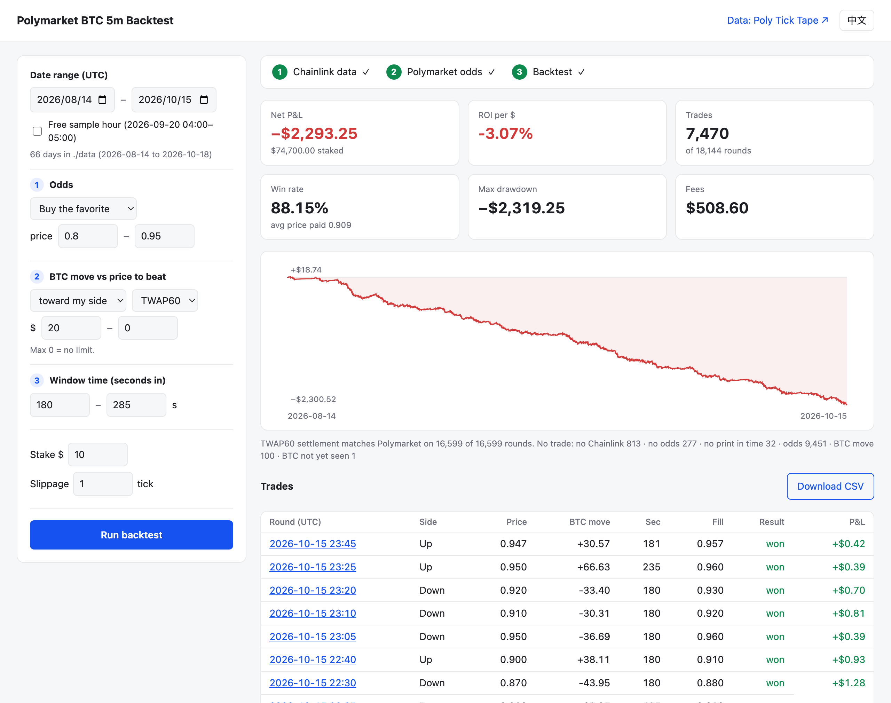

# Polymarket BTC 5-Minute Backtest

A small, honest backtester for Polymarket's **Bitcoin Up or Down 5-minute** markets. It replays every round second by second on the data the market actually settles on, **Chainlink BTC/USD TWAP60**, together with Polymarket's own trade prints. It has three conditions, one web page, and no dependencies.

[中文说明](README.zh-CN.md) · [Settlement examples](https://github.com/polyticktape/polymarket-btc-5m-examples) · [Data: Poly Tick Tape](https://polyticktape.com/?ref=bt)



*The default strategy over 63 days (18,144 rounds): buy the favorite at 0.80–0.95 when BTC is at least $20 past the price to beat, 180–285 s into the round. It wins 88% of the time and still loses 3% after fees and one tick of slippage. Finding that out cheaply is what this tool is for.*

```bash
git clone https://github.com/polyticktape/polymarket-btc-5m-backtest
cd polymarket-btc-5m-backtest
python backtest.py            # opens http://127.0.0.1:8765, the free sample hour works right away
```

Python 3.9 or newer. Nothing to `pip install`.

---

## Why the BTC 5-minute market

- **A lot of rounds.** 288 a day, about 8,600 a month. A strategy that trades once in ten rounds still gets 800+ trades a month to judge it by, where a daily market would give you 30.
- **Settlement you can recompute.** Since 2026-08-14 a round resolves **Up** when Chainlink's 60-second TWAP at the end second is ≥ the TWAP at the start second. That's a number, not a judgment call. This repo recomputes it for every round, and it matched Polymarket's resolution on **16,599 of 16,599** rounds where both boundary seconds were present.
- **Real liquidity.** Polymarket reports a median of about **$42,500 traded per round**, with around **1,400 taker trades** inside each 5-minute window (2026-08-14 to 10-15).
- **Binary, bounded payoffs.** A share costs p and pays $1 or $0. The taker fee is a known formula (`shares × 0.07 × p × (1−p)`), so P&L is exact and the most you can lose per trade is your stake.
- **Open 24/7, with a clean start.** No sessions, no expiry roll. Every round starts on a Unix second divisible by 300, so rounds line up with the data by construction.

## Strategy directions

Each of these is a setting of the three conditions. The results are on the same 63 days, with $10 per trade, one tick of slippage and taker fees:

| Direction | Odds (side, price) | BTC move | Window time | Trades | Win rate | Avg price paid | ROI |
|---|---|---|---|---:|---:|---:|---:|
| **Late favorite** (default) | favorite 0.80–0.95 | ≥ $20 toward it | 180–285 s | 7,470 | 88.15% | 0.909 | **−3.07%** |
| Same, zero slippage | | | | 7,470 | 88.15% | 0.899 | −2.04% |
| Same, plain Chainlink price for the move | | | | 9,338 | 87.95% | 0.902 | −2.53% |
| **Last seconds** | favorite 0.95–0.985 | ≥ $30 toward it | 270–295 s | 137 | 98.54% | 0.974 | +1.13% |
| **Early momentum** | favorite 0.55–0.70 | ≥ $15 toward it | 30–120 s | 7,168 | 64.17% | 0.680 | −5.80% |
| **Odds lag a BTC jump** | favorite 0.50–0.80 | ≥ $40 toward it | 120–240 s | 3,200 | 71.47% | 0.767 | −6.96% |
| **Reversal** | underdog 0.10–0.35 | $0–15 against it | 200–270 s | 5,357 | 20.03% | 0.258 | −25.23% |
| **Lottery tickets** | underdog 0.02–0.10 | any | 240–290 s | 9,263 | 4.22% | 0.072 | −48.72% |
| Baseline: first print of every round | favorite 0.50–0.99 | any | 0–299 s | 17,053 | 58.25% | 0.619 | −6.10% |

Directions this repo deliberately leaves out: **market making** (resting quotes, maker rebates and queue position, which trade prints can't show) and **cross-venue lag** (Binance vs Chainlink, which needs a third data feed).

## Is it feasible?

The short answer is that the market is well priced and the costs are real.

- **The odds are calibrated.** Across the rows above the win rate sits close to the price paid. Favorites win about as often as their price says, sometimes a point more. That point is the whole edge.
- **Costs are about the same size as that edge.** At a price of 0.90 the taker fee is 0.63¢ a share and one tick of slippage is 1¢. The late-favorite row loses 3.07%. Zero slippage cuts that to 2.04%, and fees alone cost $509 of the $2,293 loss.
- **Small positive rows aren't proof.** "Last seconds" is up $15.54 on 137 trades, and one losing trade at 0.97 costs $10. It's also exactly where execution assumptions matter most: in the last seconds a print's timestamp can lag the real match by a few seconds, and the book moves faster than you can.
- **Underdogs are the expensive side.** Cheap shares lose to the fee curve and to the longshot bias.

So what makes a strategy work is usually not a clever filter. It's **execution**: getting filled near the price you saw, paying less in fees (maker orders), and reacting faster than the prints suggest. A backtest can't give you those, but it can show you in seconds which ideas are dead before you risk money on them. That's the job this repo does.

## What's in this repository

| File | What it does |
|---|---|
| `backtest.py` | Entry point. Opens the web UI, or runs `run` / `download` in the terminal |
| `chainlink.py` | **Step 1.** Loads the Chainlink price and TWAP60 files, or downloads them with your API key |
| `odds.py` | **Step 2.** Fetches each round's trades from Polymarket's public API and caches them in `cache/` |
| `engine.py` | **Step 3.** The three conditions, fills, fees, settlement and the summary numbers |
| `web/` | One page: a form, three progress steps, the results |
| `sample/` | One free hour of both Chainlink streams (2026-09-20 04:00–05:00 UTC) plus its odds, so everything runs offline |
| `tests/` | `python -m unittest` |

### Load order

Every run goes through the same three steps, in this order:

1. **Chainlink data.** The files for every day in your range must be in `./data`. If any are missing the run stops and asks you to get them: in the UI as a dialog that lists the missing files, with a key box to download them, and in the terminal as a message.
2. **Polymarket odds.** Only after step 1 succeeds. Rounds already in `cache/` are skipped. The first fetch of a day takes about 2–3 minutes. After that, re-runs are instant.
3. **Backtest.** Change a condition and press Run again. Data stays in memory.

### Run it

**Web UI.** Run `python backtest.py`, set the range and the three conditions, then press Run. Every trade links to its round on Polymarket, and the full trade list exports to CSV. You can share a configuration as a URL, for example `http://127.0.0.1:8765/?from=2026-09-14&to=2026-10-13&prob_min=0.85&autorun=1`.

**Terminal:**

```bash
python backtest.py run --sample
python backtest.py run --from 2026-09-14 --to 2026-10-13 \
    --side favorite --prob 0.80-0.95 --move 20 --move-mode with --elapsed 180-285 --csv trades.csv
```

```
Range        2026-09-14 to 2026-10-13 UTC, 8640 rounds
Trades       3801  (3355 won)
Win rate     88.27%   avg price paid 0.910 incl. fees
Net P&L      -$1,151.18 on $38,010.00 staked  (ROI -3.03%)
Fees         $256.38
Max drawdown $1,190.45
Settlement   TWAP60 matches Polymarket on 8385/8385 rounds
No trade     noChainlink 129, noOdds 32, time 20, odds 4621, move 37
```

| Option | Meaning | Default |
|---|---|---|
| `--side` | `favorite` or `underdog` | favorite |
| `--prob` | price range of the side you buy | 0.80-0.95 |
| `--move` | BTC minus the price to beat, in USD: `20` or `20-80` | 20 |
| `--move-mode` | `with` (toward your side), `against`, `any` | with |
| `--btc` | stream that measures the move: `twap60` or `price` | twap60 |
| `--elapsed` | seconds into the round | 180-285 |
| `--stake` / `--slippage` | USD per trade / ticks added to each fill | 10 / 1 |
| `--data` / `--cache` | folders (put these before `run`) | ./data, ./cache |

### What the engine assumes

- **Odds** come from **taker BUY prints**. A taker buying Up at 0.83 in second 212 means you could have bought Up at 0.83 then. Each second and side keeps its highest print, the conservative end. The engine never infers one side's price from the other's.
- **BTC is what you could have seen.** The move uses the newest Chainlink row whose `recv_ms` had arrived by that second, usually 1.5–3 s old. A signal never uses a value from the future, and the price to beat only counts once it has arrived.
- **Fill** = print + slippage ticks (0.01, or 0.001 below 0.04 and above 0.96). Fills at 0.99 or higher are skipped. One trade per round, held to settlement.
- **Settlement.** P&L uses Polymarket's resolution, which is what you'd actually be paid. TWAP60 is recomputed with exact decimals as a check.
- **Not modeled:** order-book depth, queue position, and the few seconds between a match and its print timestamp. Treat results as an upper bound on what live trading gets.

## Getting the data

| What | Where | Cost |
|---|---|---|
| Chainlink BTC/USD **price** and **TWAP60**, every second since 2026-08-14 | [Poly Tick Tape](https://polyticktape.com/pricing/?ref=bt) | $2.99 per month of history, or $5.99/month for a rolling 60 days |
| One free hour of both streams | `sample/` in this repo | free (CC BY-NC 4.0) |
| Polymarket odds and resolutions | Polymarket's public Gamma and Data APIs, fetched for you | free, no key |

After you buy, your API key is on the account page:

```bash
export POLYTICKTAPE_KEY=ptt_your_key_here
python backtest.py download --from 2026-09-14 --to 2026-10-13
python backtest.py run --from 2026-09-14 --to 2026-10-13
```

Or paste the key into the dialog the UI shows when data is missing. Files already downloaded with the right SHA-256 are skipped, so a re-run doesn't use download quota twice. Files bought elsewhere work too: drop any `btc-price-YYYY-MM-DD.jsonl.gz` and `btc-twap60-YYYY-MM-DD.jsonl.gz` into `./data`.

Each line of those files is one second:

```json
{"ts":1789878900,"p":"80413.342489811802390528","v":80413.3424898118,"lag":1568,"feed_ts_ms":1789878900000,"server_ts_ms":1789878901244,"recv_ms":1789878901568}
```

`p` is the full-precision value used to compare settlement, `v` is a float for math, and `recv_ms` is when the collector received the value, which is what makes the backtest causal. Missing seconds are left missing, never filled in.

## FAQ

**How does the Polymarket 5-minute Bitcoin market settle?**
On Chainlink's BTC/USD TWAP60 data stream: Up if the TWAP at the end second is ≥ the TWAP at the start second. It's been this way since 2026-08-14. Before that it was a 30-second TWAP, and before 2026-08-07 a plain Chainlink price. Full write-up with sources: [How Polymarket's 5-minute Bitcoin markets settle](https://polyticktape.com/guides/polymarket-5-minute-settlement/?ref=bt).

**Can I backtest with Binance or Coinbase prices instead?**
Not reliably. Even Chainlink's plain BTC/USD price gives the opposite result to TWAP60 in about 11% of rounds ([details](https://github.com/polyticktape/polymarket-btc-5m-examples)). An exchange price is further off still.

**Is Polymarket historical data free?**
Trades and resolutions are, through Polymarket's public APIs, and this repo fetches them for you. The per-second Chainlink TWAP60 the markets settle on isn't kept anywhere public, which is why it's sold separately.

**Why does the first run take a while?**
Polymarket's Data API returns each round's trades in pages, so a day is about 600 requests. Those are cached in `cache/`, and every later run reads them from disk.

**Windows / Linux?**
Yes. It's plain Python and the standard library.

**Can I add my own conditions?**
Yes. Each condition is a few lines in `engine.run()`, and `tests/test_engine.py` shows how to check a new one with synthetic data.

## Disclosure

I run [Poly Tick Tape](https://polyticktape.com/?ref=bt), which sells the Chainlink data this backtest reads. The code works with any files in the format above, wherever you got them. The strategy numbers on this page are what the code prints. They aren't picked to look good, and most of them lose money.

Not affiliated with Polymarket or Chainlink. Nothing here is financial or trading advice. Prediction markets may not be available where you live, so check your local rules.

## License

Code: [MIT](LICENSE). Sample data in `sample/`: [CC BY-NC 4.0](sample/README.md), with attribution to Poly Tick Tape (polyticktape.com). Odds in `sample/` are derived from Polymarket's public trade data.

<sub>Keywords: Polymarket backtest, Polymarket BTC 5 minute, Bitcoin Up or Down, Polymarket bot, Chainlink TWAP60, Chainlink BTC/USD historical data, prediction market backtesting, Polymarket trading strategy, Polymarket historical data, Python.</sub>
