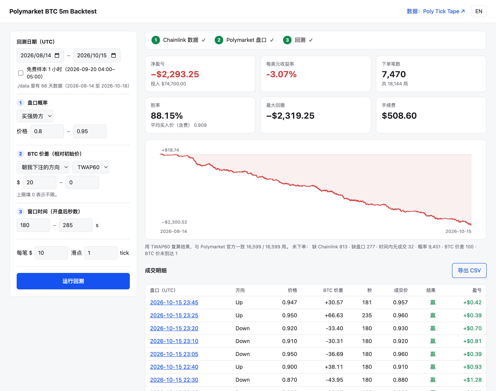

# Polymarket BTC 5 分钟涨跌 · 极简回测

一个小而诚实的 Polymarket **Bitcoin Up or Down 5 分钟**盘口回测工具。它逐秒重放每一局，用的是这个市场真正的结算数据 **Chainlink BTC/USD TWAP60**，加上 Polymarket 自己的逐笔成交。只有三个条件、一个网页，不需要安装任何依赖。

[English](README.md) · [结算示例仓库](https://github.com/polyticktape/polymarket-btc-5m-examples) · [数据：Poly Tick Tape](https://polyticktape.com/zh/?ref=bt)



*默认策略跑 63 天（18,144 局）：开盘后 180–285 秒，BTC 已经朝强势方偏离初始价至少 $20，且强势方价格在 0.80–0.95 时买入。胜率 88%，扣掉手续费和 1 个 tick 滑点后仍然亏 3%。用最低的成本发现这一点，就是这个工具存在的意义。*

```bash
git clone https://github.com/polyticktape/polymarket-btc-5m-backtest
cd polymarket-btc-5m-backtest
python backtest.py            # 打开 http://127.0.0.1:8765，免费样本可以直接跑
```

需要 Python 3.9 或以上，不需要 `pip install`。

---

## 为什么是 BTC 5 分钟市场

- **样本多**：每天 288 局，每月约 8,600 局。一个每 10 局才出手一次的策略，一个月也有 800 多笔交易可以评估；日级市场一个月只有 30 个样本。
- **结算可以复算**：2026-08-14 起，结束秒的 Chainlink 60 秒 TWAP ≥ 开始秒的 TWAP 判 **Up**，否则判 Down。这是一个数字比较，没有主观判断。本仓库会逐局复算：在首尾两秒数据都齐的 **16,599 局里，与 Polymarket 官方结果 16,599 局全部一致**。
- **流动性真实**：Polymarket 报告每局成交额中位数约 **$42,500**，每个 5 分钟窗口内约 **1,400 笔 taker 成交**（2026-08-14 至 10-15）。
- **收益二元、亏损有上限**：一份成本 p，结算时值 $1 或 $0；taker 手续费是公开公式（`股数 × 0.07 × p × (1−p)`），盈亏可以精确计算，每笔最多亏掉本金。
- **7×24 小时，边界整齐**：没有交易时段、没有换月；每局开始时间都是能被 300 整除的 Unix 秒，和数据天然对齐。

## 策略的几个方向

每个方向都只是三个条件的一种取值。下面是同样 63 天的结果：每笔 $10、1 个 tick 滑点、按 taker 收费：

| 方向 | 盘口概率（方向，价格） | BTC 价差 | 窗口时间 | 笔数 | 胜率 | 平均买入价（含费） | ROI |
|---|---|---|---|---:|---:|---:|---:|
| **末段买强势方**（默认） | 强势方 0.80–0.95 | 朝它 ≥ $20 | 180–285 秒 | 7,470 | 88.15% | 0.909 | **−3.07%** |
| 同上，零滑点 | | | | 7,470 | 88.15% | 0.899 | −2.04% |
| 同上，价差改用 Chainlink 普通价 | | | | 9,338 | 87.95% | 0.902 | −2.53% |
| **最后几秒** | 强势方 0.95–0.985 | 朝它 ≥ $30 | 270–295 秒 | 137 | 98.54% | 0.974 | +1.13% |
| **早段动量** | 强势方 0.55–0.70 | 朝它 ≥ $15 | 30–120 秒 | 7,168 | 64.17% | 0.680 | −5.80% |
| **BTC 跳动后盘口滞后** | 强势方 0.50–0.80 | 朝它 ≥ $40 | 120–240 秒 | 3,200 | 71.47% | 0.767 | −6.96% |
| **押反转** | 弱势方 0.10–0.35 | 逆它 $0–15 | 200–270 秒 | 5,357 | 20.03% | 0.258 | −25.23% |
| **买彩票** | 弱势方 0.02–0.10 | 不限 | 240–290 秒 | 9,263 | 4.22% | 0.072 | −48.72% |
| 基准：每局第一笔成交就买 | 强势方 0.50–0.99 | 不限 | 0–299 秒 | 17,053 | 58.25% | 0.619 | −6.10% |

本仓库刻意没做的方向：**做市**（挂单、maker 返佣、排队位置，这些成交数据里看不到）和**跨市场延迟**（Binance 对 Chainlink，需要第三条数据）。

## 可行性

简单说：这个市场定价很准，交易成本是实打实的。

- **赔率是准的**：上表中胜率都贴着买入价，强势方赢的频率和价格基本一致，有时高 1 个点左右。这 1 个点就是全部的 edge。
- **成本和这点 edge 差不多大**：价格 0.90 时，taker 手续费是每份 0.63 美分，1 个 tick 滑点是 1 美分。末段买强势方亏 3.07%；零滑点降到 2.04%；$2,293 的亏损里光手续费就占 $509。
- **小样本的正收益不算数**：「最后几秒」137 笔赚了 $15.54，而在 0.97 买入输一笔就亏 $10。最后几秒也正是执行假设最脆弱的地方：成交打印的时间戳可能比真实撮合晚几秒，订单簿也比你动得快。
- **弱势方是更贵的一边**：便宜的份额会被手续费曲线和「冷门偏差」吃掉。

所以一个策略能不能成，通常不在于过滤条件有多聪明，而在于**执行**：能不能在看到的价格附近成交、能不能少付手续费（挂单）、能不能比成交打印更快。回测给不了这些，但它能在几秒内告诉你哪些想法根本不用上真钱试。这就是这个仓库要做的事。

## 仓库里有什么

| 文件 | 作用 |
|---|---|
| `backtest.py` | 入口：打开网页界面，或在终端跑 `run` / `download` |
| `chainlink.py` | **第 1 步**：读取 Chainlink 价格和 TWAP60 文件，或用 API Key 下载 |
| `odds.py` | **第 2 步**：从 Polymarket 公开接口抓每一局的成交，缓存到 `cache/` |
| `engine.py` | **第 3 步**：三个条件、成交、手续费、结算、汇总指标 |
| `web/` | 一个页面：参数表单、三步进度、结果 |
| `sample/` | 免费 1 小时样本（2026-09-20 04:00–05:00 UTC），含两条 Chainlink 流和对应盘口，离线可跑 |
| `tests/` | `python -m unittest` |

### 加载顺序

每次运行都按这三步、按这个顺序：

1. **Chainlink 数据**：所选日期的文件都必须在 `./data` 里。缺任何一个就停下，提示去获取数据：网页上弹窗列出缺少的文件，并提供填 API Key 直接下载的输入框；终端里打印提示信息。
2. **Polymarket 盘口概率**：第 1 步成功后才开始。`cache/` 里已有的局直接跳过；某一天第一次抓取约 2–3 分钟，之后再跑都是秒出。
3. **回测**：改条件后再点运行即可，数据留在内存里。

### 运行

**网页界面**：运行 `python backtest.py`，设好日期和三个条件，点「运行回测」。每笔成交都链接到 Polymarket 上的对应盘口，全部成交可导出 CSV。参数也可以写进网址分享，比如 `http://127.0.0.1:8765/?from=2026-09-14&to=2026-10-13&prob_min=0.85&autorun=1&lang=zh`。

**终端**：

```bash
python backtest.py run --sample
python backtest.py run --from 2026-09-14 --to 2026-10-13 \
    --side favorite --prob 0.80-0.95 --move 20 --move-mode with --elapsed 180-285 --csv trades.csv
```

| 参数 | 含义 | 默认 |
|---|---|---|
| `--side` | `favorite` 强势方 / `underdog` 弱势方 | favorite |
| `--prob` | 要买那一方的价格区间 | 0.80-0.95 |
| `--move` | BTC 减初始价（美元）：`20` 或 `20-80` | 20 |
| `--move-mode` | `with` 朝我方向 / `against` 反方向 / `any` 不限 | with |
| `--btc` | 价差用哪条流：`twap60` 或 `price` | twap60 |
| `--elapsed` | 开盘后第几秒 | 180-285 |
| `--stake` / `--slippage` | 每笔金额（美元）/ 每笔加几个 tick | 10 / 1 |
| `--data` / `--cache` | 数据目录（写在 `run` 前面） | ./data、./cache |

### 引擎的假设

- **概率**取自 **taker 主动买单**：第 212 秒有人以 0.83 主动买 Up，说明那一秒你也能以 0.83 买到 Up。每一秒每一方取最高价，偏保守。绝不用对手方价格推算本方价格。
- **BTC 价只用当时看得到的**：价差取 `recv_ms` 已经到达的最新一条 Chainlink 数据（通常是 1.5–3 秒前的）。信号绝不使用未来数据；初始价也要等它那一行到达之后才算已知。
- **成交价** = 打印价 + 滑点 tick（0.01；价格低于 0.04 或高于 0.96 时为 0.001）；≥ 0.99 视为买不到。每局最多一笔，持有到结算。
- **结算**：盈亏按 Polymarket 官方结果（这才是真正到手的钱）；同时用 TWAP60 精确小数复算，作为校验。
- **没有模拟**：订单簿深度、排队位置、撮合到打印时间戳之间的几秒延迟。请把结果当作实盘表现的上限。

## 获取数据

| 数据 | 从哪里来 | 价格 |
|---|---|---|
| Chainlink BTC/USD **价格**和 **TWAP60**，2026-08-14 起每秒一条 | [Poly Tick Tape](https://polyticktape.com/zh/pricing/?ref=bt) | 单月历史 ¥22.99 / $2.99；订阅滚动 60 天 ¥45.99 / $5.99 每月 |
| 两条流的免费 1 小时样本 | 本仓库 `sample/` | 免费（CC BY-NC 4.0） |
| Polymarket 盘口概率与结算结果 | Polymarket 公开的 Gamma 与 Data API，程序自动抓取 | 免费，无需 Key |

购买后在账户页拿到 API Key：

```bash
export POLYTICKTAPE_KEY=ptt_your_key_here
python backtest.py download --from 2026-09-14 --to 2026-10-13
python backtest.py run --from 2026-09-14 --to 2026-10-13
```

也可以在网页缺数据的弹窗里直接粘贴 Key 下载。SHA-256 校验一致的文件会跳过，重复运行不会浪费下载次数。从其他地方得到的同格式文件也可以用：把 `btc-price-YYYY-MM-DD.jsonl.gz` 和 `btc-twap60-YYYY-MM-DD.jsonl.gz` 放进 `./data` 即可。

文件每行是一秒：

```json
{"ts":1789878900,"p":"80413.342489811802390528","v":80413.3424898118,"lag":1568,"feed_ts_ms":1789878900000,"server_ts_ms":1789878901244,"recv_ms":1789878901568}
```

`p` 是全精度值，结算比较用它；`v` 是浮点数，方便计算；`recv_ms` 是采集端收到这条数据的时间，回测靠它做到不偷看未来。缺失的秒保持缺失，不插值、不补齐。

## 常见问题

**Polymarket 5 分钟比特币盘口怎么结算？**
按 Chainlink BTC/USD TWAP60 数据流：结束秒的 TWAP ≥ 开始秒的 TWAP 判 Up。这个规则从 2026-08-14 开始；之前一周是 30 秒 TWAP，2026-08-07 以前是 Chainlink 普通价格。详细说明和来源见[Polymarket 5 分钟比特币盘口如何结算](https://polyticktape.com/zh/guides/polymarket-5-minute-settlement/?ref=bt)。

**能不能用 Binance 或 Coinbase 的价格回测？**
不可靠。就连 Chainlink 的普通 BTC/USD 价格，也有约 11% 的局和 TWAP60 结果相反（[详情](https://github.com/polyticktape/polymarket-btc-5m-examples)），交易所价格偏得更多。

**Polymarket 历史数据是免费的吗？**
成交和结算结果是免费的，通过 Polymarket 公开接口获取，本仓库会自动抓取。但这些盘口据以结算的逐秒 Chainlink TWAP60 没有公开存档，所以单独出售。

**第一次运行为什么慢？**
Polymarket Data API 按页返回每一局的成交，一天大约 600 次请求。抓过的数据缓存在 `cache/`，之后的运行都直接读硬盘。

**支持 Windows / Linux 吗？**
支持，纯 Python 标准库。

**能加自己的条件吗？**
能。每个条件在 `engine.run()` 里只有几行代码，`tests/test_engine.py` 演示了怎样用合成数据验证新条件。

## 利益相关

我经营 [Poly Tick Tape](https://polyticktape.com/zh/?ref=bt)，出售本回测读取的 Chainlink 数据。代码适用于上面这种格式的任何文件，不管你从哪里得到。本页的策略数字都是程序实际输出的结果，没有挑好看的，其中大多数是亏钱的。

与 Polymarket、Chainlink 无关联。本仓库内容不构成任何投资或交易建议。预测市场在你所在的地区可能不合法或受限，请先确认当地法规。

## License

代码：[MIT](LICENSE)。`sample/` 中的样本数据：[CC BY-NC 4.0](sample/README.md)，使用时请注明 Poly Tick Tape（polyticktape.com）。`sample/` 中的盘口数据来自 Polymarket 公开成交数据。
